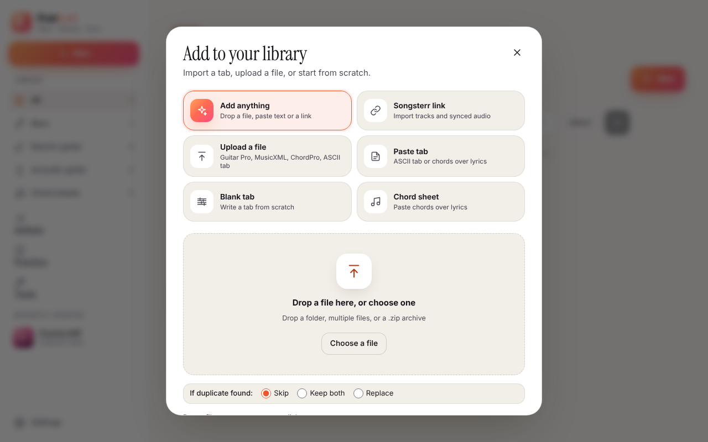

# Importing songs

Press **Add** in the library. The first mode, **Add anything**, takes a dropped file, pasted text or a pasted link
and works out what it is from the *content*, not the file name. The other ways in are listed below.

## Supported formats

| What | Notes |
| --- | --- |
| Guitar Pro 3–8 (`.gp3` … `.gp`, `.gpx`) | Read by alphaTab in the browser, and on the server for uploads, watched folders and bulk imports (`FRETBOOK_GP_CONVERTER`; the Docker image has it). |
| MusicXML (`.musicxml`, `.xml`, compressed `.mxl`) | |
| MIDI (`.mid`, `.midi`) | Pitches but no strings: Fretbook asks which parts to import, see [MIDI](#midi). |
| ASCII tab (`.tab`, or `.txt` that holds a tab) | Rhythm is estimated, see [Paste tab](#paste-tab). |
| ChordPro (`.cho`, `.chordpro`, `.crd`, `.txt`) | Becomes a chord sheet. A `.txt` is read as tab when it holds a tab system, and as a chord sheet otherwise. |
| Chords over lyrics (pasted) | Converted to ChordPro. |
| Fretbook JSON | Fretbook's own format, also what a library archive holds. |
| Audio | Becomes a song with a blank tab and the audio attached, ready for tapping sync or typing the tab. |
| PDF and images | Recognised, but not importable yet; the message says so. |

Drop several files, a folder or a `.zip` archive at once. You get per-file progress and duplicate detection (**skip**,
**replace** or **keep both**).

## Links

Links are routed by site:

- **Songsterr** (`https://www.songsterr.com/a/wsa/…-s123`). If the song has several fretted tracks, you pick which
  to import. The import runs in the background. If you pasted the link again later it refreshes the song and keeps your
  sync marks; if you edited the tab, the new import is saved separately.
- **Ultimate Guitar** (`tabs.ultimate-guitar.com/tab/…`). A *Chords* page becomes a chord sheet with the page's key and
  capo; a *Tabs* or *Bass Tabs* page goes through the ASCII tab importer. *Official* and *Pro* tabs are Guitar Pro
  based and are not available as text, so they are refused with a message. This is for personal use of tabs you could
  already open in a browser. The site may block datacenter and VPN addresses, in which case the import fails with
  "could not be read".
- **YouTube**: a blank tab with the video's audio, when audio downloads are on.
- **A direct link** to any supported file, or **any other page**, which is searched for a linked tab file and then for
  a `<pre>` block holding a tab.

Fetching a link is safe against server-side request forgery: only `http` and `https`; every address the host resolves to
must be public (set `FRETBOOK_ALLOW_PRIVATE_URLS=true` to allow your LAN); redirects are re-checked at every hop (at
most 5); and the download is capped by size (`FRETBOOK_FETCH_MAX_BYTES`) and time (`FRETBOOK_FETCH_TIMEOUT`).

If YouTube refuses the audio download (common from datacenter addresses), the tab is still saved and you can upload an
mp3 on the song page. See [Keeping yt-dlp working](ytdlp.md).

## Paste tab

In the Add sheet, paste ASCII tab (or a chords-over-lyrics sheet) and see it drawn before you save. The importer reads
string labels and tunings in either order, multi-digit frets, `h p / \ b r ~ x ( ) < >`, bar lines and repeat signs,
`x4` markers, `[Verse]` headers and `PM` rows, and skips chord names and lyrics between systems.

ASCII tab has no rhythm, so note lengths are **estimated** from the spacing in each bar on a grid you choose (eighth
notes by default; tempo and time signature are optional). The song is marked "Rhythm estimated". Check the timing
before you play along.

## MIDI

A `.mid` file has pitches but no strings, so Fretbook asks first: which tracks and channels to import (guitar and bass
programs are ticked by default, drums are skipped), an instrument preset with its tuning for each, a capo, and the grid
to snap notes to (sixteenths by default). Frets are then assigned to keep the hand close to where it was and within a
four-fret stretch. Notes the instrument cannot reach are moved by octaves, and the import says so. Tempo and
time-signature events are kept. A MIDI file that arrives without the dialog (in a folder, a zip, a bulk import) imports
every guitar and bass part with suggested instruments.

## Other ways in

- A [watched inbox folder](inbox.md) for tabs kept on a NAS share, Syncthing or Nextcloud.
- The [command line](cli.md) for scripts and cron.
- A library archive restored from [Backups](../self-hosting/backups.md).
- bass-tab-sync `songs/<slug>/` folders in `FRETBOOK_LEGACY_SONGS_DIR` are imported on start.

## After importing

- **Default instrument** (top of the library) is a per-user setting. It is the preset for new tabs and added tracks, and
  decides which Songsterr parts start checked.
- **Tags and favourites.** Free-form tags (per user, up to 30 of 40 characters) and a favourite star, edited on the song
  page. In the library, pick several tag chips to show songs that have all of them, turn on *Favourites*, or use *Select*
  to tag many songs at once. A new import starts with tags the file gives away, such as the instrument, an alternate
  tuning like Drop D, the capo, and the key of a chord sheet.
- **Export** a song as MusicXML, MIDI, ChordPro, Fretbook JSON or PDF from its export menu.

## Chord sheets

Lyrics with chords over them, stored as ChordPro. You can transpose and print them. A sheet shows a diagram for every
chord it uses, for guitar, bass or ukulele and the common alternate tunings, with a voicing picker. A ChordPro
`{define: Am7 base-fret 1 frets x 0 2 0 1 0}` is offered first. **Tools → Chord library** searches any chord name,
lists its voicings and strums them.
