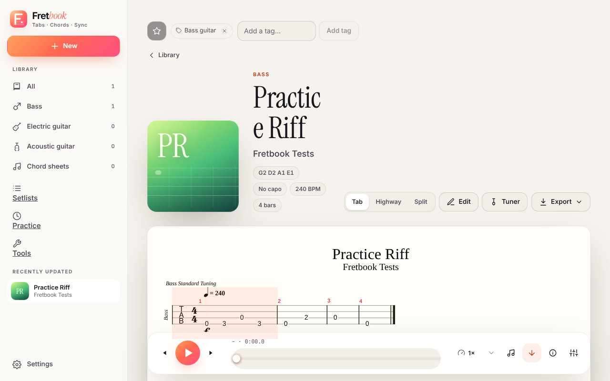

# Playing and syncing

## Playing a tab

Open a song. **Space** plays, the arrow keys move a bar, and `?` lists every shortcut. Without a recording, alphaTab's
synth plays the tab. Standard notation and tab are drawn by [alphaTab](https://alphatab.net).

Switch between **Tab**, **Highway** and **Split** on any tab song page; Fretbook remembers it per user.

- **Highway.** Notes travel along coloured string lanes toward a hit line, with fret numbers, sustain tails, technique
  glyphs (hammer-on/pull-off, slides, bends, palm mute, vibrato, harmonics), chord blocks with names, bar and beat
  lines, and upcoming section labels.
- **Fretboard.** In the Sync & audio panel, switch on **Show the fretboard under the score**. An SVG neck for the
  track's own strings, tuning and capo lights the notes sounding now and fades the next three. Label the dots with note
  names, intervals (from a root you pick) or fret numbers, and mirror it for left-handed players.

## Playing along with a recording

Add audio on the song page (upload an mp3, or let the Songsterr import download the audio of the video it syncs to).
The score then follows the recording.

### Syncing

A recording and a score only line up if you tell Fretbook where each bar starts.

1. Open the Sync & audio panel and start the recording.
2. Press **T** at the start of each bar, against the audio. Those are the *sync marks*.
3. Use Loop A/B, speed and the nudge buttons to line up a stretch that drifts.

Songsterr imports that carry sync data already have marks. Importing the same song again keeps yours. The metronome
and count-in follow the marks.

If the song changed elsewhere since you opened it (for example sync marks tapped in another tab), saving merges your
edits on top. Real conflicts ask you to reload.

## Editing

The editor changes bars, which every track shares, so time signatures, tempo changes, sections, and inserting or
deleting a bar apply to the whole song, and sync marks move with their bars.

## Setlists

Named, ordered lists of songs for a rehearsal or a gig. Reorder by dragging or with the keyboard, add a note per song
(key, capo, "skip solo") and a transpose per chord sheet, then **Play through** to step from song to song (Alt with
← or →). **Export PDF** makes one file with a contents page followed by every song. A song can be in many setlists, and
setlists are part of the library backup.

## Language

English and Brazilian Portuguese. The header switcher remembers the choice. With none saved, the browser language is
used (`pt` and `pt-PT` select `pt-BR`).
