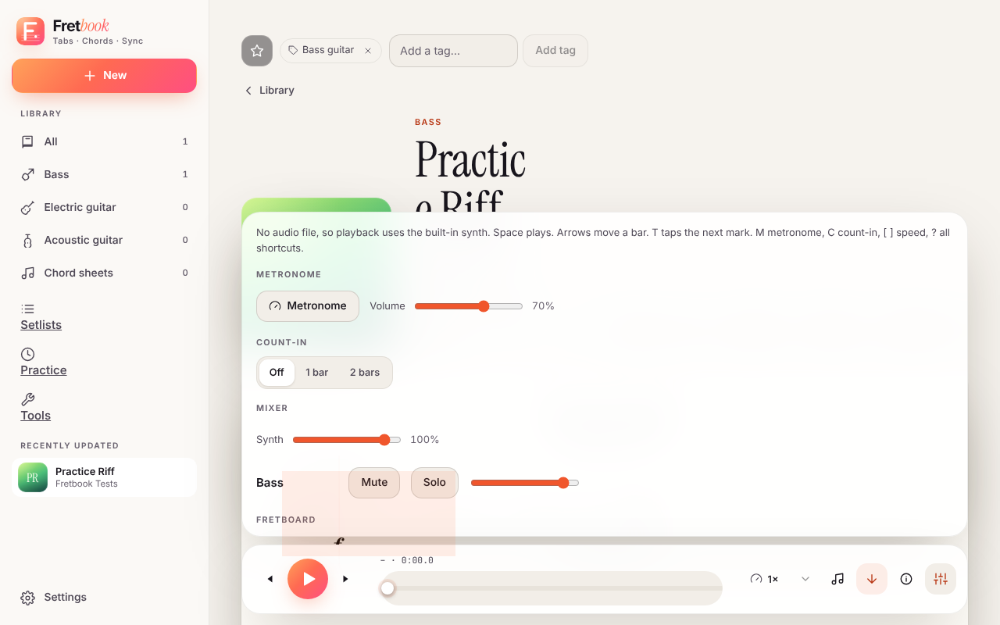

# Practice modes

Everything here is in the **Sync & audio** panel on a song page, or under **Tools** and **Practice** in the sidebar.

!!! warning "The microphone needs HTTPS"
    Wait mode, scored play-along, the tuner and latency calibration listen to your instrument. Browsers allow that only
    on HTTPS pages and `localhost`. See [Reverse proxy and HTTPS](../self-hosting/reverse-proxy.md). Audio never leaves
    the browser.

## Practice controls

- **Metronome** that follows the song's tempo and time-signature changes (and its sync marks, when a recording plays).
- **Count-in** of one or two bars, optionally before each loop pass.
- **Volume** for the recording or the synth, and mute, solo and volume for each track while the synth plays.
- **Speed.** Slowing a recording keeps its pitch.
- **Loops.** Set an A/B range from playback, save it with a name ("Solo", "Bridge riff"), and jump to it with the
  quick-jump buttons in the song header. `?loop=<id>` in the URL links to one.
- **Speed trainer.** Set a start %, a target %, a step % and the passes per step. After that many passes the tempo
  rises until the target is reached, counting in between passes. The highest speed reached is saved on the loop.

Settings are remembered per song, in this browser. Shortcuts: `M` metronome, `C` count-in, `X`/`S` mute/solo the shown
track, `-`/`+` volume, `[`/`]` speed.

## Wait mode

On a tab without a recording press **Wait for me**. The cursor stops on each note of the chosen track until the
microphone hears you play it (the right note in any octave counts by default). The other tracks play as backing, or
turn the synth off.

A beat of several different notes is checked as a chord, by its pitch content rather than string by string, so it is
lenient (a missing or slightly wrong string still counts) and you can skip a beat. Turn that off in the panel to accept
any one note of the chord. On a chord sheet, press **Wait for me** above the sheet: the lit chord is the one to strum,
and the next lights up when it is heard.

## Scored play-along

Press **Score my playing**, then play along with the recording or the synth without stopping. Each note of the chosen
track is graded on time, early, late, wrong or missed, with a live accuracy and streak, and the highway colours each
note. At the end of the song (or the loop) a results screen shows the score, stars, accuracy per section and a heatmap of
bars. **Practise this section** loops the weakest part.

Wear headphones so the microphone does not hear the recording, and run **Settings → Audio latency calibration** first.
It measures the round-trip delay between sound output and microphone input with a click/tap wizard, stored per device
pair per user, with a manual offset.

## Tuner and metronome

**Tools** has a standalone tuner (it follows the instrument's own tuning on a song page) and a metronome.

The tuner lets you pick the audio input, and the channel too when your interface has several. A level meter shows what
the microphone hears, and Fretbook remembers the device and each device's channel.

## Ear and fretboard trainer

**Tools → Ear & fretboard trainer** has three games. Pick a round length (30, 60 or 120 seconds, or no limit) and press
**Start**; the score, streak and time left are shown while you play.

- **Fretboard notes**: a note and a string are shown ("C on string 1"). Find it by tapping the fretboard, or play it on
  your instrument (the microphone listens, as in the tuner). Pick the tuning to match your instrument. A wrong answer
  shows where the note was. Strings you miss come up more often, and the table under the game keeps accuracy and
  average time per string and tuning.
- **Intervals**: two notes play one after the other. Name the interval with the buttons, or play the second note on your
  instrument (any octave). Choose the easy set (3rds, 4th, 5th, octave) or all twelve, going up, down or both.
- **Chord qualities**: a chord plays; name it (major, minor, diminished, augmented, sus4 and the sevenths). Buttons only.

Wait for the sound to finish before you play. The best score for each game is kept in this browser; the time and score of
each game also go into the practice log below.

## Rhythm trainer

**Tools → Rhythm trainer** drills rhythm without a song. Pick a pattern (quarters to sixteenths, rests, off-beats,
syncopation, a gallop, triplets), a tempo and a number of bars. It shows the pattern as notation with strum arrows
(down on the beat, up in between), counts you in with one bar of clicks, and then clicks only the beats: the
subdivisions are yours to feel.

Play along by pressing **Space**, tapping the pad, or strumming a muted string with **Listen with the microphone** on.
Each hit is matched to the nearest expected one, and the result shows how many you hit, the average error and spread
in milliseconds, a histogram of early and late hits, and whether you tend to **rush** or **drag**.

Microphone hits are corrected by the round-trip latency from the [calibration](#scored-play-along) in Settings; taps and
key presses are corrected by half of it (the output half). Without a calibration nothing is subtracted, so a laggy
Bluetooth setup will look like dragging.

## Practice log

The time you spend playing a tab is logged automatically, per song, track and loop, with the speed and the mode (free
play, wait mode, scored play-along with its accuracy). A pause shorter than a minute stays in the same session, and
stretches under five seconds are not logged. A wait-mode session is flagged **completed** when you played the whole
song through (every note of the track from the first one, no loop); [lessons](../lessons.md#pass-conditions) use that flag.

The **Practice** page shows a progress ring for the day's minutes against your daily goal (default 15; 0 turns it off),
the current and longest streak, songs practised, a calendar heatmap, a weekly summary, recently practised songs, best
scores, and songs you have not played in two weeks. Days follow your browser's local midnight. Trainer games count toward the day's minutes, the streak and the heatmap, and are listed on the Practice page; the
practice log, trainer games included, is part of the library backup.

## Difficulty and what to practise next

Every tab gets an estimated **difficulty from 1 to 10**, worked out from its score: how many notes come per second at
the written tempo, how far the fretting hand jumps along the neck, how wide the chord stretches are, how many notes use
bends, slides, hammer-ons, harmonics or vibrato, how often the chord shape changes, and how many beats are tuplets,
off the sixteenth-note grid or in odd time signatures. The library card shows the level, the library can be sorted by
difficulty (easiest first; songs without a level come last) and filtered to easy (1–3), medium (4–6)
or hard (7–10), and the song page has a **Difficulty** section listing each track's level and what contributes most.
A chord sheet is rated from its chords instead: how many different chords it uses, how many of them are barre chords
or extended chords (ninths, diminished, added notes and the like), and how often the chord changes from line to line.
A sheet with no chords has no level. Barre chords are recognised by name (anything that is not a common open shape),
not from the diagram shown on the page.

It is a heuristic, not a verdict: it cannot see how the music sounds or how you fret it. Changing a song's tempo or
notes updates its level, and songs saved before this feature are rated when the server starts.

The **Practice** page suggests what to play next:

- **A step up**: tabs a little harder (up to 1.5 levels) than the level you have shown lately, that you have played at
  most twice. Your level is the median difficulty of the songs you scored 80 % or better on in the last 30 days, or of
  the songs you practised if you have not scored any. With no history it suggests the easiest tabs.
- **Loops to revisit**: loops whose latest scored attempt in the last 60 days was under 70 %, lowest first.
- **Due for a refresher**: songs you have not played for longer than a gap that doubles with every day you have
  practised them (1, 2, 4, 8 … days, at most 60), the most overdue first.

## Checking it by hand

Manual browser checks for the practice controls are in
[docs/practice-controls.md](https://github.com/liftedkilt/fretbook/blob/main/docs/practice-controls.md) in the
repository.
