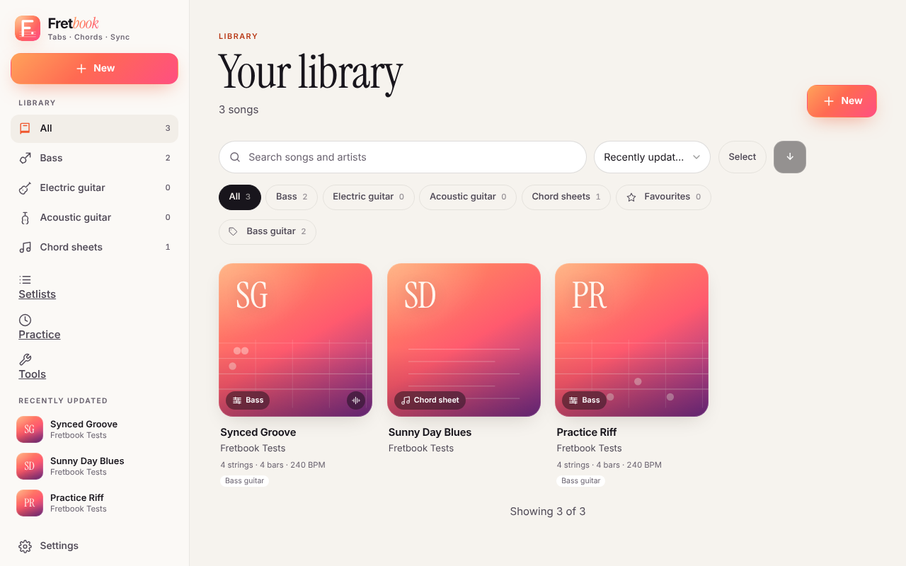

# Fretbook

Self-hosted tabs, chord sheets and sheet music for bass and guitar. Import from Songsterr, Ultimate Guitar,
Guitar Pro, MusicXML, MIDI, ASCII tab or ChordPro; play along with a recording; practise with a metronome,
loops, a speed trainer, a tuner and wait mode.

## Where to start

- **I want to run it.** [Getting started](getting-started.md), then [Docker Compose](self-hosting/docker-compose.md)
  and, to reach it from other devices, [a reverse proxy with HTTPS](self-hosting/reverse-proxy.md). The microphone
  features need HTTPS.
- **I run it for several people.** [Sign-in with OIDC](self-hosting/oidc.md) (Pocket ID, Authelia, Authentik,
  Keycloak), [backups](self-hosting/backups.md) and [upgrades](self-hosting/upgrading.md).
- **I am learning songs with it.** [Importing songs](guides/importing.md), [playing and syncing](guides/playing.md),
  [practice modes](guides/practice.md).
- **I need a setting.** The [configuration reference](reference/configuration.md) lists every `FRETBOOK_*` variable.

## Other places

- [Source code and issues](https://github.com/liftedkilt/fretbook)
- [Changelog](https://github.com/liftedkilt/fretbook/blob/main/CHANGELOG.md) and
  [releases](https://github.com/liftedkilt/fretbook/releases)
- [Security policy](https://github.com/liftedkilt/fretbook/blob/main/SECURITY.md)
- [Contributing](https://github.com/liftedkilt/fretbook/blob/main/CONTRIBUTING.md) and the
  [architecture notes](https://github.com/liftedkilt/fretbook/blob/main/docs/ARCHITECTURE.md)
